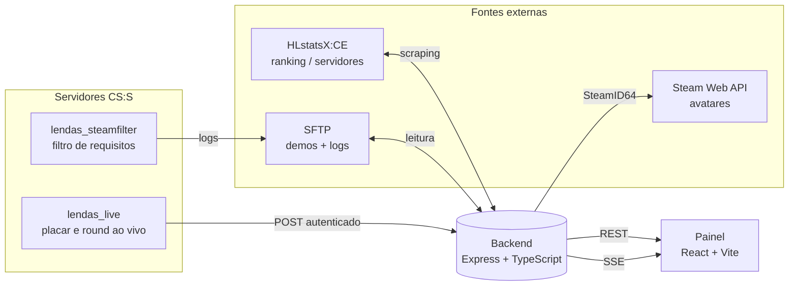

<p align="center">
  
</p>

<p align="center">
  <strong>Painel web da comunidade LEGION — Counter-Strike: Source</strong><br/>
  Placar ao vivo · Ranking · Demos · Banimentos · Estatísticas
</p>

---

# LEGION Network

Painel web da comunidade **LEGION**, uma rede de servidores Counter-Strike: Source. Mostra status de servidor, ranking, catálogo de demos, banimentos e placar ao vivo — tudo puxado de fontes reais, sem dado inventado: quando uma informação não existe na fonte, o painel diz isso explicitamente em vez de fingir.

## Arquitetura



## Estrutura

```
painel/   → frontend (React 19, TypeScript, Vite, Tailwind v4)
server/   → backend próprio (Express, TypeScript, zod)
plugins/  → fontes dos plugins SourceMod que o site depende
```

Os plugins rodam no servidor de jogo, não aqui — mas os fontes moram em
`plugins/` de propósito: em 29/08/2026 uma cópia de servidor sobrescreveu o
`lendas_demos.smx` por uma versão antiga e o fonte da versão correta não
existia em lugar nenhum, deixando o servidor dois dias sem gravar demo.
Binário compilado não é fonte. Ver `plugins/README.md`.

## Integrações reais

| Dado | Fonte | Como |
|---|---|---|
| Servidores, mapa, lotação | HLstatsX:CE | Scraping de HTML (sem API estruturada) |
| Ranking de jogadores | HLstatsX:CE | Scraping de HTML |
| Catálogo de demos | SFTP do servidor | Descoberta automática de pastas |
| Atividade (entradas/bloqueios) | Logs do `lendas_steamfilter` | Lidos via SFTP, mesma conexão das demos |
| Placar, round, scoreboard ao vivo | Plugin `lendas_live` | POST autenticado → SSE |
| Avatar de jogador ao vivo | Steam Web API | Resolvido pelo backend a partir do SteamID64 real |
| Banimentos | Plugin `lendas_bans` (JSON via SFTP) | MySQL inacessível remotamente |
| Avatares no ranking | Plugin `lendas_players` (índice nick→SteamID64) | SFTP |
| Estatísticas | HLstatsX páginas weapons/actions/maps | Scraping de HTML |
| Pódios por jogador | Plugin `lendas_playerstats` (JSON via SFTP) | SFTP |

## Limitações conhecidas (documentadas, não escondidas)

- Não existe evento de "saída" no feed de atividade — o plugin de requisitos não loga desconexão, só o veredito da entrada.
- Avatar de jogador no ranking histórico não é obtível (a instalação do HLstatsX trava ao renderizar o perfil individual de qualquer conta com avatar Steam real) — só jogadores **ao vivo** têm avatar real.
- "Intervalo" (halftime) nunca aparece na fase da partida — o CS:S clássico não dispara um evento confiável pra essa transição.
- Pódios de leaderboard contam só desde a instalação do plugin (sem histórico anterior).
- Bans podem ter atraso de até 5 min (intervalo de exportação do plugin).

## Rodando localmente

Requer Node 20+.

```bash
# Backend
cd server
npm install
cp .env.example .env   # preencha com credenciais reais
npm run dev             # http://localhost:8787

# Frontend (outro terminal)
cd painel
npm install
cp .env.example .env
npm run dev              # http://localhost:5173
```

Sem preencher o `.env` do backend, cada integração real fica indisponível de forma explícita (nunca cai num mock disfarçado) — os detalhes de cada variável estão comentados no próprio `.env.example` de cada pacote.

## Scripts

Em `painel/` e `server/`:

```bash
npm run dev         # ambiente de desenvolvimento
npm run build       # build de produção
npm test            # suíte de testes (só existe em server/)
npm run lint        # lint
npm run typecheck   # checagem de tipos (server/)
```

## Documentação mais a fundo

- `server/README.md` — endpoints, contratos, modelo de segurança de cada integração (demos, HLstatsX, filtro de requisitos, live, banimentos).
- `plugins/README.md` — o que cada plugin faz, como compilar e por que a versão do compilador precisa bater com a do servidor.
